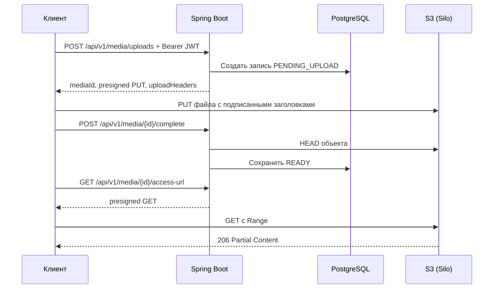

# MediaVault

Backend для приватной медиатеки. Spring Boot управляет аккаунтами, правами доступа и каталогом в PostgreSQL. Клиент передаёт файлы напрямую в S3-совместимое хранилище по временным ссылкам, минуя API.

**Стек:** Java 17, Spring Boot 4.1, Spring Security, JWT, PostgreSQL 16, Spring Data JPA, Liquibase, AWS SDK v2, OpenAPI, Actuator, Micrometer, Testcontainers, Docker Compose, GitHub Actions.

Для локального S3-хранилища Compose и Testcontainers используют поддерживаемый форк MinIO. Он сохраняет протокол, конфигурацию и формат данных MinIO. [PGSTY Silo](https://github.com/pgsty/silo)

## Запуск

```sh
docker compose up --build -d
docker compose ps
```

- Веб-интерфейс медиатеки — [localhost:8080](http://localhost:8080/)
- Swagger UI — [localhost:8080/swagger-ui.html](http://localhost:8080/swagger-ui.html)
- Готовность API, БД и бакета — [localhost:8080/actuator/health/readiness](http://localhost:8080/actuator/health/readiness)
- Метрики JVM и HTTP в формате Prometheus — [localhost:8080/actuator/prometheus](http://localhost:8080/actuator/prometheus)
- Консоль хранилища — [localhost:9001](http://localhost:9001)

Для локального запуска есть значения по умолчанию. При необходимости скопируйте [`.env.example`](.env.example) в `.env` и измените параметры. Compose публикует порты только на loopback. Для размещения за пределами локального окружения задайте собственные секреты, HTTPS и ограничьте доступ к метрикам и регистрации.

На главной странице можно создать аккаунт, загружать файлы, просматривать медиатеку и удалять записи. Интерфейс отдаётся самим Spring Boot. Для браузерной загрузки `MINIO_PUBLIC_ENDPOINT` должен быть доступен из браузера, а `MINIO_ALLOWED_ORIGIN` должен совпадать с адресом веб-интерфейса, включая схему и порт.

## Как проходит загрузка



Подписанный `If-None-Match: *` защищает объект от повторной записи по тому же URL. При подтверждении API проверяет размер, Content-Type и, если клиент передал SHA-256 при создании загрузки, контрольную сумму из метаданных S3. Content-Type описывает заявленный формат. Предел размера по умолчанию — 512 МиБ.

JWT живёт 30 минут. Идентификатор владельца берётся из подписанного `sub`. Каталог использует стабильную сортировку по времени создания и UUID. Для чужой записи API возвращает `404`, включая запросы на подтверждение и удаление.

`complete` и `DELETE` можно повторить для своей записи. Удаление сразу скрывает её из каталога. Время физической очистки учитывает срок действия PUT-ссылки и запас в 24 часа. Ранее выданная GET-ссылка может работать до своего истечения или до очистки объекта. Фоновая задача забирает записи из PostgreSQL через `FOR UPDATE SKIP LOCKED` и повторяет неудачные удаления из хранилища.

## API

| Метод и путь | Назначение |
| --- | --- |
| `POST /api/v1/auth/register` | Создать аккаунт, пароль хранится в виде BCrypt-хеша |
| `POST /api/v1/auth/token` | Получить Bearer JWT |
| `POST /api/v1/media/uploads` | Создать запись и получить URL и заголовки для PUT |
| `POST /api/v1/media/{id}/complete` | Подтвердить загрузку. Тело запроса необязательно |
| `GET /api/v1/media?page=0&size=20` | Получить страницу своего каталога |
| `GET /api/v1/media/{id}` | Получить метаданные |
| `GET /api/v1/media/{id}/access-url` | Получить временную ссылку на готовый объект |
| `DELETE /api/v1/media/{id}` | Скрыть запись и запланировать физическую очистку |

### Демо в PowerShell

Укажите путь к любому MP3-файлу. Передайте заголовки из `uploadHeaders` как есть. В браузере `Content-Length` устанавливает сам браузер по размеру тела PUT.

```powershell
$api = 'http://localhost:8080/api/v1'
$file = Get-Item 'demo.mp3'
$credentials = @{
    username = 'demo_' + [guid]::NewGuid().ToString('N').Substring(0, 8)
    password = 'local-demo-password'
} | ConvertTo-Json -Compress

Invoke-RestMethod "$api/auth/register" -Method Post -ContentType 'application/json' -Body $credentials
$token = Invoke-RestMethod "$api/auth/token" -Method Post -ContentType 'application/json' -Body $credentials
$auth = @{ Authorization = "Bearer $($token.accessToken)" }
$metadata = @{
    filename = $file.Name
    mimeType = 'audio/mpeg'
    sizeBytes = $file.Length
    checksumSha256 = (Get-FileHash -LiteralPath $file.FullName -Algorithm SHA256).Hash.ToLowerInvariant()
} | ConvertTo-Json -Compress

$upload = Invoke-RestMethod "$api/media/uploads" -Method Post -Headers $auth -ContentType 'application/json' -Body $metadata
$putArgs = @('--fail-with-body', '--upload-file', $file.FullName)
foreach ($header in $upload.uploadHeaders.PSObject.Properties) {
    $putArgs += @('--header', "$($header.Name): $($header.Value)")
}
curl.exe @putArgs $upload.uploadUrl
if ($LASTEXITCODE -ne 0) { throw 'S3 PUT failed' }

$media = "$api/media/$($upload.mediaId)"
Invoke-RestMethod "$media/complete" -Method Post -Headers $auth
$access = Invoke-RestMethod "$media/access-url" -Headers $auth
curl.exe --fail-with-body --range 0-1023 --output fragment.mp3 $access.downloadUrl
```

## Опциональный профиль Kafka и Redis

Для базового запуска достаточно обычного `docker compose up --build -d`. Чтобы добавить обработку изображений и ограничение выдачи PUT-ссылок, укажите в `.env`:

```dotenv
COMPOSE_PROFILES=media-processing
MEDIA_UPLOADS_PER_MINUTE=10
```

Затем используйте ту же команду запуска. Нужен Compose 2.20.0 или новее. Переменная `COMPOSE_PROFILES` включает сервисы Kafka и Redis и передаёт одноимённый профиль Spring в backend. Порты Kafka и Redis остаются внутри Docker-сети.

- После успешного `POST /api/v1/media/{id}/complete` для JPEG и PNG до 16 МиБ PostgreSQL сохраняет `READY` и запись outbox в одной транзакции. Издатель забирает записи через `FOR UPDATE SKIP LOCKED` и удаляет их после подтверждения Kafka. В топике `media.ready.v1` ключ и значение сообщения содержат UUID объекта.
- Kafka-обработчик проверяет фактический формат и размеры изображения, создаёт JPEG с длинной стороной до 320 пикселей и сохраняет его в S3. Блокировка строки и постоянный ключ объекта позволяют обработать повторную доставку. При удалении оригинала фоновая очистка удалит и миниатюру.
- В ответе каталога и метаданных поле `thumbnailStatus` показывает `PENDING`, `READY` или `FAILED`. Для файлов без задачи оно равно `null`, в том числе для старых файлов. Владелец получает подписанную ссылку через `GET /api/v1/media/{id}/thumbnail-url`. Для отсутствующей миниатюры API возвращает `404`, для `PENDING` и `FAILED` — `409`.
- При ошибке инфраструктуры обработчик делает три повторные попытки. После этого событие попадает в `media.ready.v1.dlt`, а статус остаётся `PENDING`. После устранения причины можно вручную отправить UUID из сообщения обратно в `media.ready.v1` с тем же ключом. Нечитаемое изображение получает `FAILED` сразу.
- Redis атомарно ограничивает попытки выдачи ссылки на загрузку по UUID аккаунта. Окно в 60 секунд начинается с первой попытки. После превышения лимита API отвечает `429` с `Retry-After`. При недоступности Redis создание загрузок отвечает `503`. Счётчики сбрасываются при перезапуске Redis.

## Тесты и сборка

```powershell
.\gradlew.bat test bootJar
.\gradlew.bat integrationTest
```

На Linux используйте `./gradlew` вместо `.\gradlew.bat`. Для `integrationTest` нужен запущенный Docker. Testcontainers поднимает отдельные PostgreSQL и Silo и проверяет регистрацию, изоляцию владельцев, загрузку с SHA-256, запрет перезаписи, HTTP Range и удаление. GitHub Actions запускает тесты и сохраняет отчёты Gradle.

## Переход со старой версии

Liquibase сохраняет существующие строки `media_asset`, созданные исходным Hibernate. Старые UUID владельцев из `X-User-Id` не считаются учётными записями. Если данные нужны, после регистрации привяжите свои старые записи к новому `accountId` вручную, проверив соответствие владельцев. Для существующего Docker-тома PostgreSQL сначала проверьте его major-версию. Если она отличается от 16, перенесите данные через dump/restore в отдельный том.
